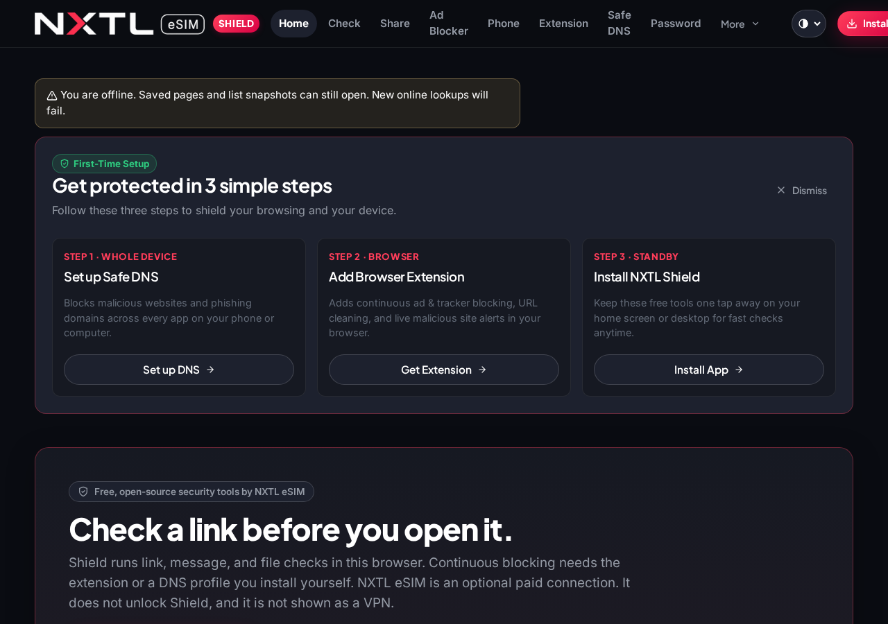
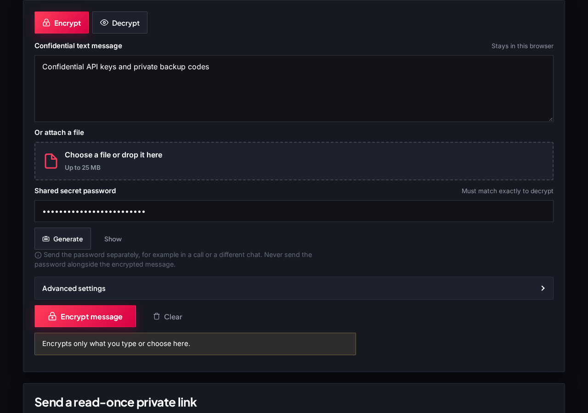
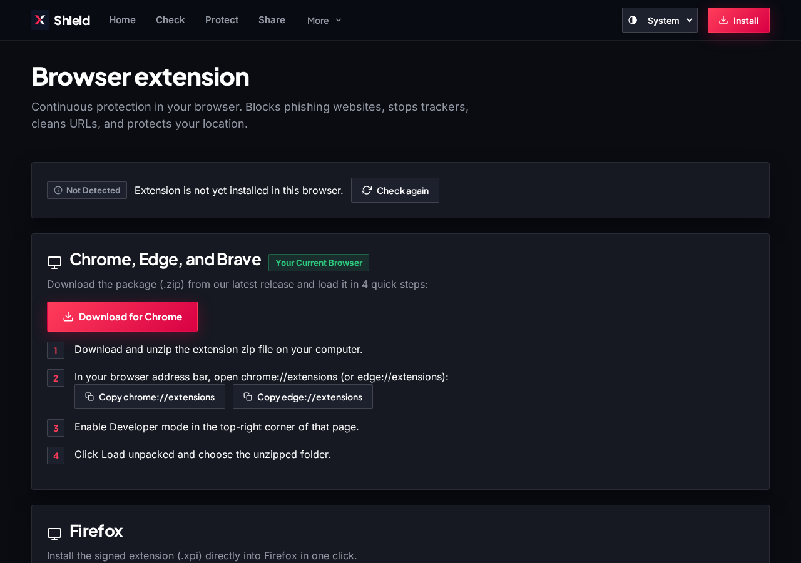

# NXTL Shield

Free, open-source tools that help you block ads and trackers, check suspicious links, turn on encrypted DNS, protect your location, and encrypt files or messages. Built by NXTL eSIM. No account required. NXTL eSIM mobile data is optional and does not unlock these tools.

## What you can do

### Block ads and trackers
Add the browser extension to stop known ad and tracker domains while you browse. Or set Safe DNS so every app on your phone or computer is filtered.

### Check a phishing or scam link
Paste a link, a text message, or a QR code before you open it. Shield checks it on your device against bundled threat lists.

### Turn on encrypted DNS
Follow short steps for Windows, Android, iPhone, Mac, and Linux. On Windows you can download a one-click setup folder. You choose a public encrypted DNS service; Shield does not run the DNS service itself.

### Protect your location
In Chromium browsers, the extension can block website location access, with exceptions you choose. Phone app permissions stay under your device settings.

### Encrypt a file or message
Secure Share encrypts text or a file on your device with a password you choose. Nothing is uploaded. Send the password through a different channel.

### Create a strong password
Generate a password on your device, copy it in one tap, and optionally check whether it has appeared in known leaks. Your password itself is never sent.

## Screenshots

| Home (desktop, dark) | Home (mobile, light) |
|---|---|
|  |  |

| Secure Share | Browser extension |
|---|---|
|  |  |

More captures (check result, ad blocker, phone protection, light and dark, 390 and 1280) are in [`docs/screenshots/`](docs/screenshots/).

## Install

- **Web app:** open [https://nxtlsim.github.io/nxtl-shield/](https://nxtlsim.github.io/nxtl-shield/) and use Install or Add to Home Screen when your browser offers it.
- **Hugging Face Space:** [https://nxtl-esim-nxtl-shield.static.hf.space/](https://nxtl-esim-nxtl-shield.static.hf.space/)
- **Chromium extension:** download [nxtl-shield-chromium.zip](https://github.com/nxtlsim/nxtl-shield/releases/latest/download/nxtl-shield-chromium.zip), then in chrome://extensions turn on Developer mode and choose Load unpacked.
- **Firefox extension:** install the signed [nxtl-shield-firefox.xpi](https://github.com/nxtlsim/nxtl-shield/releases/latest/download/nxtl-shield-firefox.xpi).

## Windows one-click Safe DNS

1. On the [Safe DNS setup page](https://nxtlsim.github.io/nxtl-shield/#/setup), download the Windows setup folder and unzip it.
2. Double-click `nxtl-shield-windows-dns.cmd` and allow it to run as administrator.
3. Restart your browser.

The folder also includes an undo script, Chrome/Edge policy files, and a Firefox policy file. The one-click setup uses the recommended profile that blocks ads, trackers, and scams.

## Privacy

Checks, encryption, and password generation run in your browser. Shield does not create an account and does not collect browsing history. Optional checks (leaked passwords, public IP, NXTL eSIM plan prices) run only when you choose them. See [docs/privacy.md](docs/privacy.md).

## FAQ

**Is NXTL Shield free?**  
Yes. The web tools and extension are free. NXTL eSIM is an optional paid product.

**Do I need an NXTL eSIM?**  
No.

**Does Shield collect my browsing history?**  
No. Extension settings stay in the browser. Threat lists ship with the app.

**Does Secure Share upload my files?**  
No. Encryption and decryption stay on your device.

**Will it stop every scam?**  
No. New or unknown sites may be missed. Treat results as guidance.

**Does location blocking work on Firefox?**  
Not through the extension. Use your browser or device permission settings.

**Where do I report a problem?**  
[GitHub Issues](https://github.com/nxtlsim/nxtl-shield/issues).

## Open source

Licence: GPL-3.0-or-later. Third-party lists and libraries keep their own licences — see [docs/sources.md](docs/sources.md).

## Links

- Live web app: https://nxtlsim.github.io/nxtl-shield/
- Hugging Face Space: https://nxtl-esim-nxtl-shield.static.hf.space/
- Firefox add-on (unlisted): https://addons.mozilla.org/en-US/firefox/addon/nxtl-shield/
- Source: https://github.com/nxtlsim/nxtl-shield
- NXTL eSIM: https://nxtlsim.com
