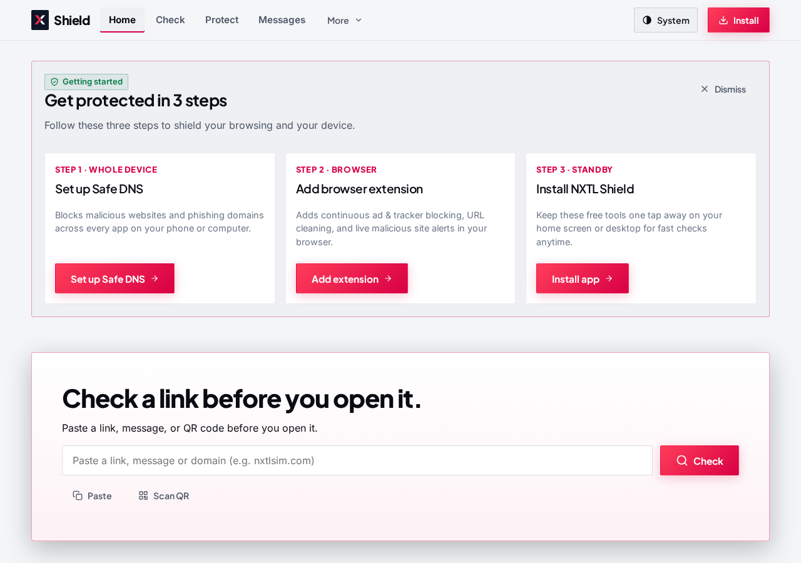
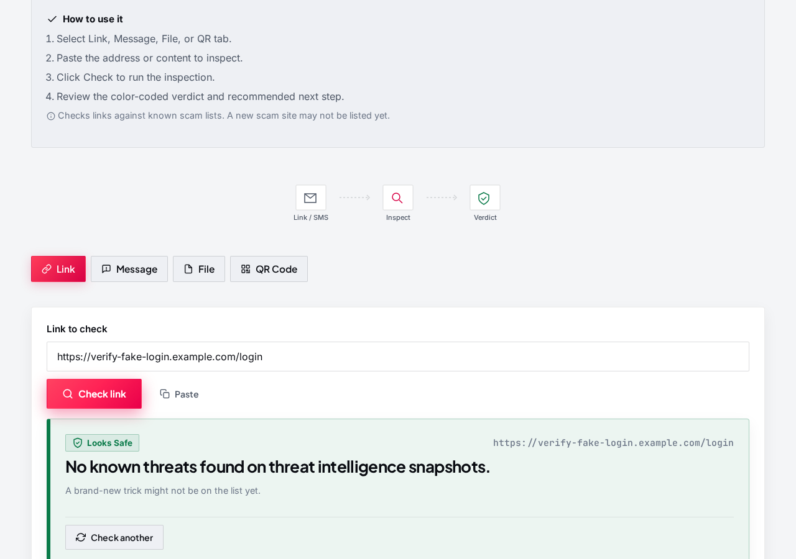
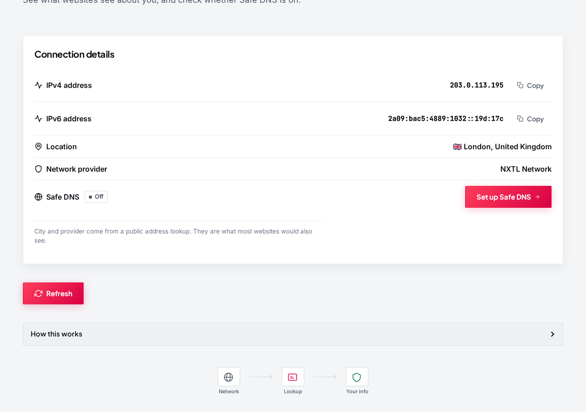
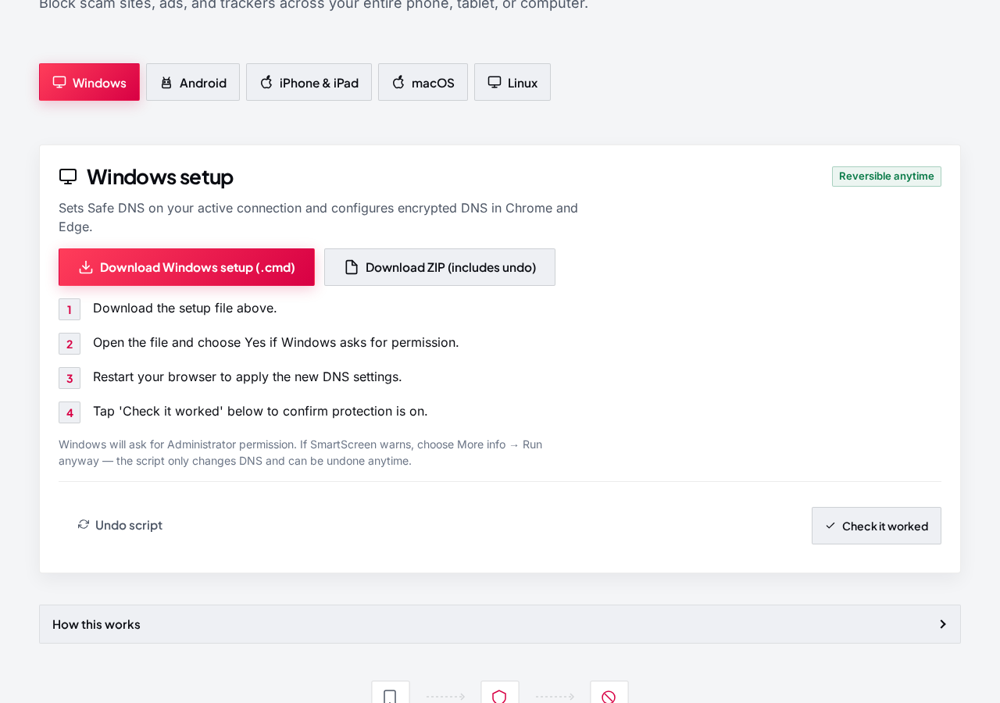
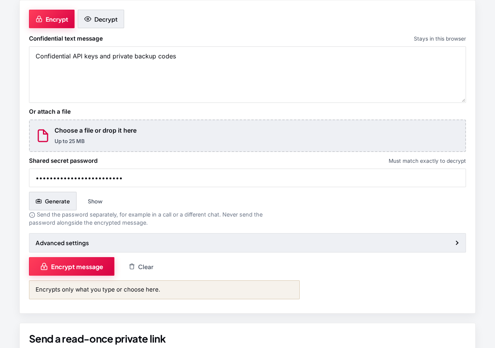
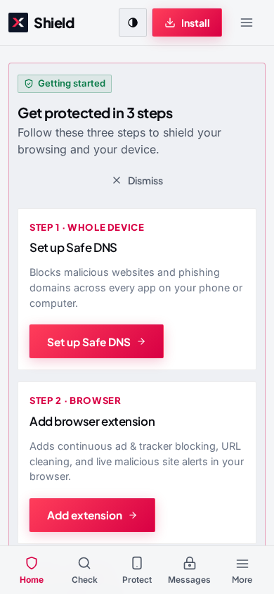

# NXTL Shield

Free, open-source tools that help you block ads and trackers, check suspicious links and messages, turn on encrypted DNS, see what websites see about your connection, protect your location, and encrypt files or messages. Built by NXTL eSIM. No account required. All tools are free. NXTL eSIM is our travel data service.

## Screenshots

| Home | Check a message |
|---|---|
|  |  |

| Your connection | Safe DNS setup |
|---|---|
|  |  |

| Private messages & files | Home on a phone |
|---|---|
|  |  |

More captures, including light and dark at 390 and 1280, are in [`docs/screenshots/`](docs/screenshots/).

## What you can do

### Check a link or message
Paste a link, a text message, or a QR code before you open it. Shield checks it on your device and gives a clear verdict: Likely scam, Be careful, or Looks safe.

### See your connection
Your connection shows the public IPv4 and IPv6 address, city, country, and network provider that websites can see, and checks whether Safe DNS is on.

### Block ads and trackers
Add the browser extension to stop known ad and tracker domains while you browse. Or set Safe DNS so every app on your phone or computer is filtered.

### Turn on encrypted DNS
Follow short steps for Windows, Android, iPhone, Mac, and Linux. On Windows you can download a one-click setup file. You choose a public encrypted DNS service; Shield does not run the DNS service itself.

### Protect your location
In Chromium browsers, the extension can block website location access, with exceptions you choose. Phone app permissions stay under your device settings.

### Encrypt a file or message
Private messages & files encrypts text or a file on your device with a password you choose. Drop a file onto the page or type a message. Nothing is uploaded. Send the password through a different channel. You can also create a private link for a short message. That link works once, then the message is gone.

### Share Shield
Know someone who gets scam texts? Share the official Shield link with them from the app, by copy, email, text message, or QR code.

### Create a strong password
Generate a password on your device, copy it in one tap, and optionally check whether it has appeared in known leaks. Your password itself is never sent.

## Install

- **Web app:** open [https://nxtlsim.github.io/nxtl-shield/](https://nxtlsim.github.io/nxtl-shield/) and use Install or Add to Home Screen when your browser offers it.
- **Hugging Face Space:** [https://nxtl-esim-nxtl-shield.static.hf.space/](https://nxtl-esim-nxtl-shield.static.hf.space/)
- **Chromium extension:** download [nxtl-shield-chromium.zip](https://github.com/nxtlsim/nxtl-shield/releases/latest/download/nxtl-shield-chromium.zip), then in chrome://extensions turn on Developer mode and choose Load unpacked.
- **Firefox extension:** install the signed [nxtl-shield-firefox.xpi](https://github.com/nxtlsim/nxtl-shield/releases/latest/download/nxtl-shield-firefox.xpi).

## Windows one-click Safe DNS

1. On the [Safe DNS setup page](https://nxtlsim.github.io/nxtl-shield/#/setup), download the Windows setup file (`.cmd`), or the undo script (`.cmd`) to revert anytime. Both work alone without extra files. A ZIP bundle is also available.
2. Open the file and allow it to run as administrator.
3. Restart your browser.

The setup configures Safe DNS for your active network connections. It uses the recommended profile that blocks ads, trackers, and scams, and can be undone anytime.

## Privacy

Checks, encryption, and password generation run in your browser. Shield does not create an account and does not collect browsing history. Optional checks (leaked passwords, public IP, NXTL eSIM plan prices) run only when you choose them. See [docs/privacy.md](docs/privacy.md).

## FAQ

**Is NXTL Shield free?**  
Yes. The web tools and extension are free. NXTL eSIM is our travel data service.

**Do I need an NXTL eSIM?**  
No.

**Does Shield collect my browsing history?**  
No. Extension settings stay in the browser. Threat lists ship with the app.

**Does Private messages & files upload my files?**  
No. Password-protected files and messages stay on your device. A private link sends only the locked text, never the key or password, and that locked text is deleted when it is opened.

**Will it stop every scam?**  
No. New or unknown sites may be missed. Treat results as guidance.

**Does location blocking work on Firefox?**  
Not through the extension. Use your browser or device permission settings.

**Where do I report a problem?**  
[GitHub Issues](https://github.com/nxtlsim/nxtl-shield/issues).

## Open source

Licence: GPL-3.0-or-later. Third-party lists and libraries keep their own licences — see [docs/sources.md](docs/sources.md).

## Links

- Live web app: https://nxtlsim.github.io/nxtl-shield/
- Hugging Face Space: https://nxtl-esim-nxtl-shield.static.hf.space/
- Firefox add-on (unlisted): https://addons.mozilla.org/en-US/firefox/addon/nxtl-shield/
- Source: https://github.com/nxtlsim/nxtl-shield
- NXTL eSIM: https://nxtlsim.com
